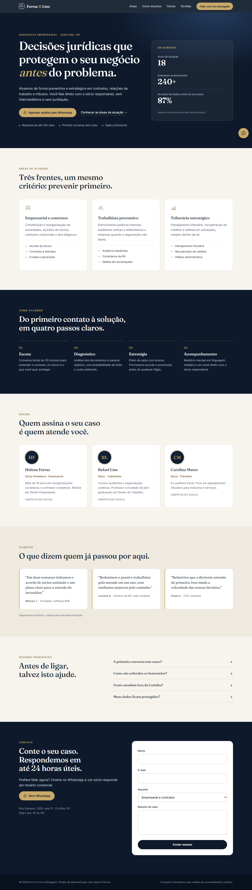

# Ferraz & Lins — law firm landing page

Conversion-focused landing page for a fictional business law firm (corporate, labor, tax). Built as a portfolio piece: all names, numbers, addresses, phone and testimonials are made up.

**Live:** https://alissonlittig.github.io/ferraz-lins-advocacia/

| Desktop | Mobile (390px) |
|---|---|
|  |  |

## What it does
- Single clear call to action (WhatsApp, pre-filled message) repeated in the hero, contact block and a floating button.
- Contact form with client-side validation and accessible error messages (demo only, nothing is sent).
- Subtle motion: scroll reveal, count-up numbers, hover lifts. All disabled under `prefers-reduced-motion`.
- Responsive from 390px with no horizontal scroll; keyboard navigable, skip link, visible focus, AA contrast.

## Stack
Plain HTML, CSS and JavaScript. No framework, no build step, no third-party requests. Fraunces and Inter are self-hosted (woff2) with `font-display: swap`.

## CI / deploy
GitHub Actions (`.github/workflows/pages.yml`): `scripts/check.mjs` validates local links, anchors, `lang`, `title` and `viewport`, then the site is published to GitHub Pages.

## Run locally
```
python -m http.server 8000
```
Open http://localhost:8000 (fonts need http, not `file://`).
